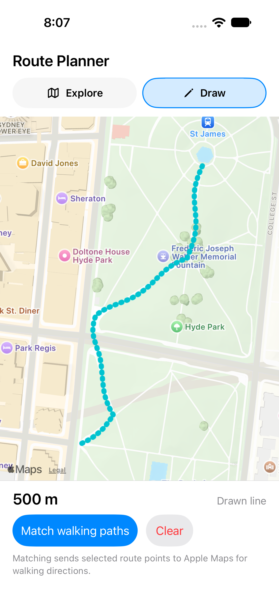

# RouteLineKit

RouteLineKit turns a finger-drawn line into a walking or running route on iPhone. Trace the streets you want to follow, cut through a park, or draw the long way around a block. The native iOS demo asks Apple Maps for walking directions along your sketch, then checks how closely those paths follow it on your device.

The demo is built in Swift with SwiftUI, UIKit touch input, MapKit, and Core Location. When two walking paths stop short of a corner, it asks Apple Maps for a short connection. You can compare the result with your original line and see exactly which stretches still need your judgment. The Swift package exposes the same matcher for use with a path network you supply.

| Original drawing | Apple Maps walking match |
| --- | --- |
|  |  |

## Try the iPhone demo

Open [RouteLineDemo.xcodeproj](Demo/RouteLineDemo.xcodeproj) in Xcode, select the **RouteLineDemo** scheme and your iPhone, choose your development team under **Signing & Capabilities**, and run. The app targets iOS 26 or later and links the package from this checkout.

1. In **Explore**, tap the location arrow to center on your position, or pan and zoom to another starting point. The app requests location access only when you tap the arrow.
2. Select **Draw** and trace a route with one finger. Lift to see its distance. A new stroke replaces the previous sketch.
3. Tap **Match walking paths**. Solid blue sections follow a matched path, dashed orange sections show an approximate match, and dotted teal sections preserve an unmatched part of the drawing. Use **Show drawing** to compare the original with the result.

The demo uses MapKit for the map and walking directions. It sends selected points along the drawing to Apple and checks the returned paths against the full stroke on the phone. When consecutive walking directions leave a gap of 2–60 m, it can request a short walking route between their endpoints. It makes at most two such requests per drawing and checks each connector’s endpoints, length and proximity to the drawn corner before using it. If the returned paths support only part of the drawing, the app shows a partial match and marks the unmatched sections.

Run **Product → Test** on an iPhone simulator to verify drawing, gap repair, partial matches, comparison, and location permissions. To include live Apple walking directions tests, enable `ROUTELINE_LIVE_LOOKUP=1` in the test environment. For command-line Xcode tests, set `TEST_RUNNER_ROUTELINE_LIVE_LOOKUP=1`. Live tests use a public route in Sydney. Package tests run offline with synthetic path networks.

## Quick start

In Xcode, choose **File → Add Package Dependencies**, enter `https://github.com/stefanoshea/RouteLineKit.git`, and choose **Up to Next Minor Version** starting at `0.1.0`. Add the `RouteLineKit` library to your target. The package requires Swift 6.2 or later and targets iOS 26 and macOS 26.

In a `Package.swift` manifest, add this entry to `dependencies` and link `.product(name: "RouteLineKit", package: "RouteLineKit")` in your target’s dependencies.

```swift
.package(url: "https://github.com/stefanoshea/RouteLineKit.git", .upToNextMinor(from: "0.1.0"))
```

```swift
import RouteLineKit

let start = Coordinate(latitude: 47.6100, longitude: -122.3300)
let end = Coordinate(latitude: 47.6104, longitude: -122.3300)
let nodes = [Node(id: 1, coordinate: start), Node(id: 2, coordinate: end)]
let ways = [Way(id: 1, nodeIDs: [1, 2])]
let matcher = StrokeMatcher(nodes: nodes, ways: ways)

let stroke = [
    start,
    Coordinate(latitude: 47.6102, longitude: -122.32999),
    end,
]
let result = matcher.resolve(stroke)
for section in result.segments {
    print(section.kind, section.distanceMeters)
}
```

Each section contains ordered coordinates, a distance in metres and a kind. A section can be `.snapped` (matched), `.approximate` (suggested) or `.freehand`. Render suggestions distinctly so the user can review them. Use `match(_:)` when you need a single connected match and can handle rejection. Use `ResolvedStroke.freehand(_:)` to retain a sketch when graph data is unavailable.

## Supplying a path network

A node has an ID and a coordinate. A way has an ID and an ordered list of node IDs. Ways connect where they share node IDs. Give paths that cross at different elevations distinct nodes at the crossing. Include intermediate vertices to preserve bends. The matcher treats every supplied edge as walkable in both directions. The caller supplies suitable edges and handles any fetching, caching and attribution for its source.

## Apple Maps

On iOS, layer a `StrokeDrawingView` over a stationary `MKMapView`. Its `onEnded` callback provides the ordered points in the drawing view's coordinate space. Convert each point with `Coordinate(map.convert(point, toCoordinateFrom: drawingView))` and pass the resulting coordinates to the matcher. To draw a resolved section, map its coordinates through `\.mapCoordinate` and use that array to construct an `MKPolyline`. A strict `Match` exposes its overlay directly as `polyline`.

## Testing

Run `swift test` from the package root. The suite covers shared-node connectivity, competing paths, sharp turns, noisy drawings, and freehand fallback. The demo has additional iOS tests for walking directions, gap repair, location permissions, and drawing on the map.

## License

The original code is available under the [MIT License](LICENSE). Map imagery in the demo screenshots is subject to the [Apple Maps terms](https://www.apple.com/legal/internet-services/maps/terms-en.html).
