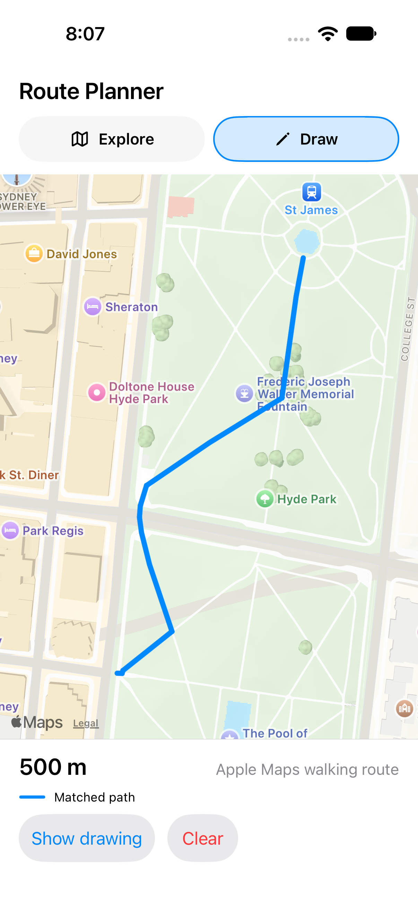

# RouteLineKit

RouteLineKit turns a finger-drawn line into a walking or running route on iPhone. Trace the streets you want to follow, cut through a park, or draw the long way around a block. RouteLineKit asks Apple Maps for walking directions along your sketch, then checks how closely those paths follow it on your device.

Starting with 0.1.1, the Swift package includes the Apple Maps lookup, gap repair, and on-device matching in `walkingRoute(for:)`. The iPhone demo calls that function from a SwiftUI screen you can run from Xcode. It shows how to draw on the map, center on your location, and compare matched paths with your original line.

| Original drawing | Apple Maps walking match |
| --- | --- |
|  |  |

## Try the iPhone demo

Open [RouteLineDemo.xcodeproj](Demo/RouteLineDemo.xcodeproj) in Xcode, select the **RouteLineDemo** scheme and your iPhone, choose your development team under **Signing & Capabilities**, and run. The app targets iOS 26 or later and links the package from this checkout.

1. In **Explore**, tap the location arrow to center on your position, or pan and zoom to another starting point. The app requests location access only when you tap the arrow.
2. Select **Draw** and trace a route with one finger. Lift to see its distance. A new stroke replaces the previous sketch.
3. Tap **Match walking paths**. Solid blue sections follow a matched path, dashed orange sections show an approximate match, and dotted teal sections preserve an unmatched part of the drawing. Use **Show drawing** to compare the original with the result.

The package uses MapKit for walking directions. It sends selected points along the drawing to Apple and checks the returned paths against the full stroke on the phone. When consecutive walking directions leave a gap of 2–60 m, it can request a short walking route between their endpoints. It makes at most two such requests per drawing and checks each connector’s endpoints, length and proximity to the drawn corner before using it. If the returned paths support only part of the drawing, the app shows a partial match and marks the unmatched sections.

Run **Product → Test** on an iPhone simulator to verify drawing, gap repair, partial matches, comparison, and location permissions. To include live Apple walking directions tests, enable `ROUTELINE_LIVE_LOOKUP=1` in the test environment. For command-line Xcode tests, set `TEST_RUNNER_ROUTELINE_LIVE_LOOKUP=1`. Live tests use a public route in Sydney. Package tests run offline with synthetic path networks.

## Quick start

In Xcode, choose **File → Add Package Dependencies**, enter `https://github.com/stefanoshea/RouteLineKit.git`, and choose **Up to Next Minor Version** starting at `0.2.0`. Add the `RouteLineKit` library to your target. The package requires Swift 6.2 or later and targets iOS 26 and macOS 26.

In a `Package.swift` manifest, add this entry to `dependencies` and link `.product(name: "RouteLineKit", package: "RouteLineKit")` in your target’s dependencies.

```swift
.package(url: "https://github.com/stefanoshea/RouteLineKit.git", .upToNextMinor(from: "0.2.0"))
```

Pass the coordinates captured from the drawing, in order. RouteLineKit fetches the walking paths from Apple Maps and compares them with the sketch. A lookup can throw if directions are unavailable or the drawing cannot be matched.

```swift
import RouteLineKit

func matchDrawing(_ drawing: [Coordinate]) async throws -> ResolvedStroke {
    try await RouteLineKit.walkingRoute(for: drawing)
}
```

Each returned section has ordered coordinates, a distance in metres, and a kind. Use `.snapped` for a matched path, `.approximate` for a suggested path, and `.freehand` for an unmatched part of the original line. The Apple Maps lookup supports continuous drawings from 15 m to 2.4 km.

On iOS, `StrokeDrawingView` captures finger input. Convert each touch point on your `MKMapView` to a package coordinate with `Coordinate(map.convert(point, toCoordinateFrom: drawingView))`. To display a returned section on an `MKMapView`, add `section.polyline` as an overlay.

## Testing

Run `swift test` from the package root. On Apple platforms this includes walking-direction lookup tests with simulated responses for gaps and detours. The core tests cover competing paths, sharp turns, noisy drawings, and freehand fallback. The example app also tests location permissions, drawing on the map, and live Apple Maps directions.

## License

The original code is available under the [MIT License](LICENSE). Map imagery in the demo screenshots is subject to the [Apple Maps terms](https://www.apple.com/legal/internet-services/maps/terms-en.html).
